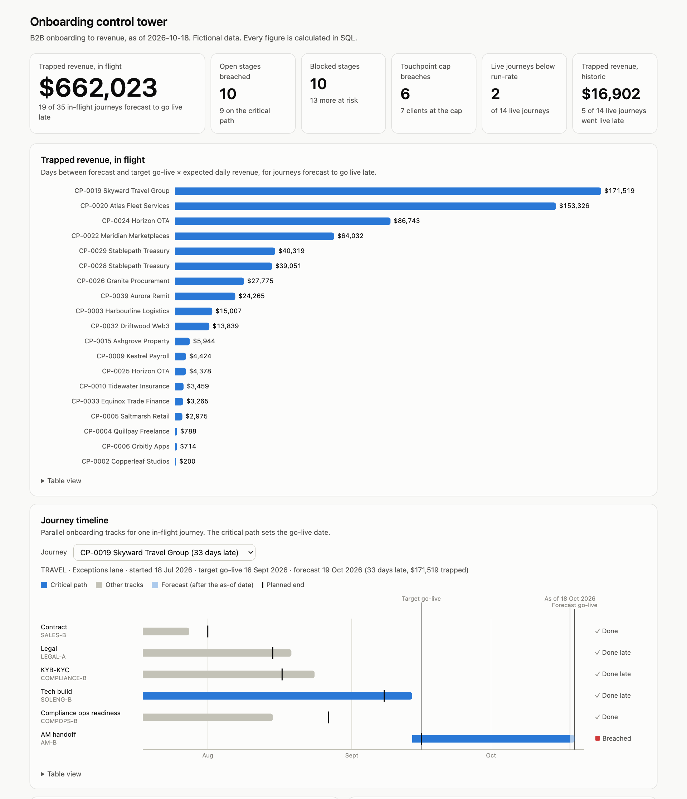

# Onboarding-to-Revenue Control Tower

[](https://github.com/hjypksm-boop/onboarding-control-tower/actions/workflows/ci.yml)

> **All data in this project is fictional.** Every company, person and figure is generated by `generate_data.py`.

## What this project shows

**The problem.** A B2B fintech closes a deal, but earns nothing until the client goes live. In between, seven teams work through parallel onboarding tracks: contract, legal, KYB/KYC, tech build, compliance ops, partner bank approval and account management handoff. When one track stalls, go-live slips, and nobody sees the cost until revenue is already late.

This project is a control tower that makes that cost visible and tells each team what to do next:

- **Four routing lanes.** Each new client-product journey is routed by rules (`routing.py`) to **Fast** (10-day target), **Standard** (30), **Complex** (60) or **Exceptions** (75, for USDC products and high-risk clients that need partner bank sign-off). A journey stalled beyond 1.5× its target escalates to Exceptions.
- **Trapped revenue.** Days late × expected daily revenue, for every journey: forecast versus target for journeys in flight, and actual versus target for journeys already live. It turns "the KYB track is late" into "$171,519 is waiting on this journey".
- **The 3-touchpoint cap.** Clients shouldn't be chased by seven teams. Post-sale requests are capped at 3 per client, with a warning at 3 and a breach above it, and teams are encouraged to bundle their asks.
- **AI agents with guardrails.** LLM agents triage blockers, draft nudges to stage owners, write the daily brief and review lane routing. **Code writes every figure; the LLM writes only wording.** Any draft that contains a number is rejected, every LLM sentence is labelled for human review, and the app runs fully without an API key.
- **Built with Python and SQL.** SQLite, with a schema written to port to Postgres. Metrics are SQL views, and the generator, metrics, checks and dashboard use only the Python standard library. The agents use the Groq API. CI runs integrity checks and tests on every push.

## Dashboard

**Live: https://hjypksm-boop.github.io/onboarding-control-tower/**



## Sample daily brief

An excerpt from `python agents.py brief`, as of 18 Oct 2026. Every line here is written by code from the SQL views. With an API key, the recommended actions are drafted by the LLM instead, under a `[DRAFT – review before sending]` label.

```text
Headline
19 of 35 in-flight journeys are forecast to go live late, trapping $662,023 of revenue; the largest
is CP-0019 Skyward Travel Group at $171,519. 10 open stages are breached (9 on the critical path)
and 10 stages are blocked.

Revenue at risk (largest trapped revenue in flight)
- CP-0019 Skyward Travel Group (TRAVEL, Exceptions lane): 33 days late, $171,519 trapped
- CP-0020 Atlas Fleet Services (CARDS, Complex lane): 43 days late, $153,326 trapped
- CP-0024 Horizon OTA (TRAVEL, Complex lane): 33 days late, $86,743 trapped

Live revenue
- Monarch Gig Works (PAYOUT) is at 71% of expected daily revenue after 253 days live; ramp shortfall so far $83,163.
- Cinder Games (PAYIN) is at 73% of expected daily revenue after 223 days live; ramp shortfall so far $71,695.

Recommended actions
- Unblock the largest trapped-revenue journey first: CP-0019 Skyward Travel Group.
- Clear the longest-blocked critical-path stage: CP-0024 Horizon OTA (Tech build).
- Review ramp plans with Monarch Gig Works, Cinder Games.
- Rebalance new work away from SOLENG-B.
```

## Quick start

```sh
python3 -m venv .venv && source .venv/bin/activate
pip install -r requirements.txt           # only needed for the agents
python generate_data.py                   # build control_tower.db, the CSVs and the metric views
python check_data.py                      # integrity checks; exits 1 on failure
python agents.py                          # all agents, or: classify | blockers | nudges | brief | lanes
python build_dashboard.py                 # rebuild docs/index.html
python -m unittest discover -s tests -v   # tests (no API calls)
```

To use the LLM, run `cp .env.example .env` and set `GROQ_API_KEY`. `.env` is gitignored. Without a key, every agent uses its code-written text.

## Agent layer

`agents.py` runs five agents on top of the views. The LLM is `openai/gpt-oss-120b` on Groq (override with `GROQ_MODEL`), called through `llm.py`. **Every figure comes from the SQL views, and every sentence that states or combines figures is written by code.**

| Agent | What it does | Code writes | LLM drafts |
|---|---|---|---|
| `classify` | Tags each blocked stage as waiting on Client, Internal or Partner bank | Keyword rules decide the clear cases | A label for edge cases (no keyword match, or conflicting matches), which must be one of the allowed labels |
| `blockers` | Blocked stages, grouped by who we're waiting on | The grouped list with days blocked, SLA and critical path | One next action per group |
| `nudges` | One message per owner with breached, at-risk or blocked stages | To, Subject, stage bullets, the ask, sign-off | The opening line: greeting and which stage to tackle first |
| `brief` | Daily brief | Title, headline, and every section: revenue at risk, onboarding health, live revenue, touchpoints, team load | The recommended actions |
| `lanes` | Lane router: re-routes every journey with `routing.py`, lists escalations that are done, due now or due within 7 days, and journeys one client attribute away from a quicker lane | The routing check, escalations and quicker-lane cases, with target days saved | A short review note |

### LLM guardrails

- **Number guard:** LLM drafts may not contain any digits apart from record IDs such as `CP-0024`. A draft that includes a count, amount, percentage, duration or date is rejected, and the code-written fallback is used. The LLM therefore can't restate figures, or combine them wrongly.
- **Code-owned facts and headline:** the brief's headline and every line with a figure come from SQL queries against the views. `tests/test_agents.py` checks that the headline's figures equal the views exactly, and that turning the LLM on changes no line containing a figure.
- **Human review label:** every piece of LLM-written text starts with `[DRAFT – review before sending]`. Nothing is sent automatically.
- **Template fallback:** with no `GROQ_API_KEY`, or if the API call fails, code-written text replaces each draft (no label), so the app runs offline.

## Dashboard details

`python build_dashboard.py` writes one self-contained page, `docs/index.html`, from the views. It uses the standard library, inline SVG and vanilla JavaScript, with no CDN or build step. It shows:

- **Headline tiles:** trapped revenue in flight and historic, breached and blocked stages, touchpoint breaches, and live journeys below run-rate.
- **Trapped revenue by journey:** ranked bars.
- **Journey timeline:** pick any in-flight journey to see its parallel tracks. The critical path is highlighted, with planned-end ticks, and the part after the as-of date shows as a forecast.
- **Open stages by SLA status per track, and team load per owner:** stacked bars.
- **Revenue ramp:** 7-day average as a share of expected revenue, highlighting the two clients that never reach the 90% run-rate.
- **Post-sale touchpoints per client, and time to second product.**

Every chart has a hover tooltip, a keyboard-focusable equivalent and a table view. Status colours always come with an icon and a label. The colours come from a categorical palette checked for colour-blind safety, with separate steps for light and dark mode. The build is deterministic, and CI fails if the committed page is out of date.

## Data model

**As-of date:** 18 Oct 2026. **Database:** SQLite (`control_tower.db`, rebuilt by `generate_data.py` and gitignored; the CSVs in `csv/` are committed).

### What's in it

- **40 clients**: 30 currently onboarding and 10 live.
- **49 client-product journeys**: 35 in flight, including 2 live clients onboarding a second product.
- **8 products**: Pay-ins, Payouts, Wallets, USDC Pay-in, USDC Payout, Verify, Cards, Travel.
- **7 teams, 17 members**: Sales, Legal, Compliance (KYB/KYC), Solutions Engineering, Compliance Ops, Partner Banking, Account Management. Members are anonymised, for example "Legal - Member A".
- **About 2,900 days of transactions** for the live journeys, plus a 12-month revenue forecast for each journey.
- **156 touchpoints**: pre-sale ones (not capped) and post-sale ones (capped at 3).

### Lanes

Lanes are derived from client attributes by `route_lane()` in `routing.py`, never hard-coded. Rules are checked in the order below, and the first match wins. The generator and the lane router agent use the same module.

| Lane | Rule | Target |
|---|---|---|
| Fast | Single no-contract product (Verify, Wallets, Pay-ins), low risk, SMB or mid-market, single entity | 10 days |
| Standard | Any other single product: a contracted product, or a no-contract product for a medium-risk, Enterprise or 2-entity client | 30 days |
| Complex | Cards or Travel, multi-product onboarding, or 3+ legal entities | 60 days |
| Exceptions | USDC products or high-risk KYB (partner bank sign-off), or any journey stalled beyond 1.5× its lane target | 75 days |

`client_products.initial_lane` stores the routed lane. `current_lane` shows escalations, such as a stalled Fast journey that moved to Exceptions.

### Onboarding model

Tracks start together on the onboarding start date and run in parallel: Contract, Legal, KYB-KYC, Tech build, Compliance ops readiness, and Partner bank approval (Exceptions only). AM handoff starts once the slowest track finishes. Go-live is the end of AM handoff.

Per-lane, per-track targets are in `stage_benchmarks`. Fast lane journeys have no Contract track. Client-level tracks (Contract, Legal, KYB-KYC, Partner bank) are shared when a client onboards two products at once. Tech build and Compliance ops readiness are tracked per product.

### Tables

| Table | Grain | Key columns |
|---|---|---|
| `teams` | Team | `team_id`, `owns_track` |
| `team_members` | Person slot | `member_id` (e.g. `SOLENG-B`), `member_label`, `role` |
| `products` | Product | `contract_required`, `partner_bank_required`, `typical_tech_effort` |
| `lanes` | Lane | `target_days`, `routing_rule` |
| `stage_benchmarks` | Lane × track | `target_days` (0 = not required), `is_parallel` |
| `clients` | Client | `segment`, `risk_rating`, `entity_count`, `client_status`, `sales_owner_id`, `am_owner_id` |
| `client_products` | Client × product journey | `product_sequence` (1st or 2nd product), `initial_lane`, `current_lane`, `target_go_live_date`, `forecast_go_live_date`, `actual_go_live_date`, `expected_daily_revenue` |
| `onboarding_stages` | Journey × track | `owner_team_id`, `owner_member_id`, planned, actual and forecast dates, `stage_status`, `blocker_note`, `blocker_since` |
| `revenue_forecast` | Journey × month | `month_number`, `expected_revenue`. Ramps at 40%, 70%, 90%, then 100% from the target go-live |
| `daily_transactions` | Live journey × day | `txn_count`, `volume_usd`, `revenue_usd` |
| `touchpoints` | Client request | `phase`, `requesting_team_id`, `request_type`, `is_bundled`, `teams_covered` |

### Metric definitions

These are implemented as views in `metrics.sql`. `v_as_of` holds the as-of date.

| View | Grain | What it gives |
|---|---|---|
| `v_stage_sla` | Stage | `sla_status`: on track, at risk (open with 75% or more of its target used) or breached. Also `is_critical_path`: the last-finishing parallel track plus AM handoff |
| `v_trapped_revenue` | Journey | In-flight and historic delay days and trapped revenue |
| `v_ramp` | Live journey | Ramp shortfall, time to expected revenue, latest 7-day average as a share of expected revenue |
| `v_second_product` | Client with a 2nd product | Days from first to second go-live, or forecast days if still onboarding |
| `v_touchpoints` | Client | Post-sale touchpoint count and `cap_status`: ok, warning or breach |
| `v_owner_workload` | Team member | Open, in-progress, blocked, not-started, breached, at-risk and critical-path stages. `active` (in progress + blocked) and `workload_rank` rank owners by the work on their desk; not-started stages wait on other tracks. A shared client-level track counts once |

- **Trapped revenue, in flight:** max(0, forecast go-live − target go-live) × expected daily revenue.
- **Trapped revenue, historic:** max(0, actual go-live − target go-live) × expected daily revenue.
- **Ramp shortfall:** the sum of (expected − actual) daily revenue from go-live until the client reaches its run-rate.
- **Time to expected revenue:** days from go-live until the 7-day average revenue reaches 90% of `expected_daily_revenue`.
- **Time to second product:** the second product's go-live date minus the first product's go-live date.
- **Touchpoint breach:** more than 3 post-sale touchpoints for a client. A warning fires at 3.

### Scenarios built into the data

These give the agents and dashboard something real to find:

- **Solutions Engineering Member B** carries a heavier queue, which shows up as a workload bottleneck.
- **Stalled journeys** escalate from Fast or Complex into Exceptions.
- **USDC and high-risk clients** wait on Partner bank approval, which is the longest track.
- **Two live clients** (Monarch Gig Works and Cinder Games) plateau below their expected revenue and never reach it.
- **Six clients** breach the 3-touchpoint cap. About a third of touchpoints are bundled, multi-team asks.
- **Second-product journeys** take from 52 to 121 days after the first product goes live.

### Assumptions

- All durations are calendar days.
- Revenue is in USD. Daily revenue depends on product and segment, with segment multipliers of SMB 0.4×, mid-market 1×, enterprise 2.5×.
- Transaction volume and count are derived from revenue using per-product take rates and average ticket sizes. Weekends run lower.

## Files

| File | Purpose |
|---|---|
| `schema.sql` | Table definitions (11 tables) |
| `metrics.sql` | Metric layer: SQLite views over the tables |
| `generate_data.py` | Builds the database and CSVs, then loads the metric views. Standard library only, seeded, so every run gives the same data |
| `routing.py` | Lane routing rules and the escalation rule, shared by the generator and the lane router agent |
| `check_data.py` | Sanity checks, plus a query against each metric view. Exits with status 1 if any integrity check fails |
| `agents.py`, `llm.py` | The agent layer and its Groq wrapper with the guardrails |
| `build_dashboard.py` | Builds the static dashboard `docs/index.html` from the views (template in `dashboard/template.html`) |
| `tests/` | Tests for the views, agents, guardrails, routing and dashboard. No API calls |
| `csv/` | One CSV per table |

CI (`.github/workflows/ci.yml`) runs on every push to `main` and every PR, on Python 3.12 and 3.13. It rebuilds the data, fails if the generated CSVs differ from the committed ones, runs the integrity checks and tests, checks the committed dashboard is up to date, and smoke-tests the agents in template mode. No API key is used.
